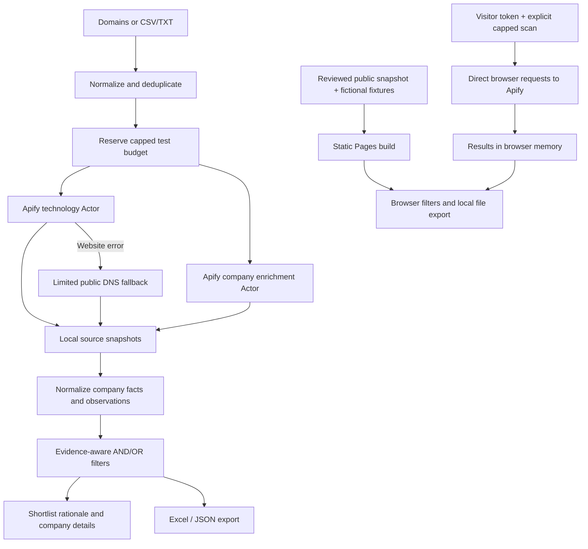

# StackSignal — Website Technology Intelligence

**Turn company domains into a sourced GTM research shortlist.**

StackSignal combines public technology observations with company profiles, lets you filter for combinations such as **HubSpot AND Figma**, and exports a company-level Excel workbook. It treats uncertain evidence as uncertain: a vendor's DNS marker is a research signal, not proof of an active subscription.

**[Open the interactive demo](https://vinaynaik432-debug.github.io/website-technology-intelligence/)** · [Source code](https://github.com/vinaynaik432-debug/website-technology-intelligence)


> Choose **Explore the test-run sample** for a cleaned snapshot of HelloFresh, N26 and Personio from 25 October 2026, or **Test with my own Apify token** to research up to five domains in the browser. Samples require no key or credits. Live research starts only when you explicitly submit it and uses your own Apify account. An eight-company fictional walkthrough is also available.

## The GTM problem

A list of companies is only a starting point. A useful research workflow should answer:

- Which companies fit the location, industry and size criteria?
- Which show signals of relevant tools or categories?
- Do they match **all** required tools, or **any** of several alternatives?
- How was each signal found, and what still needs verification?
- Can the shortlist be handed to another person in a usable spreadsheet?

For example, someone exploring an integration between a CRM and a design workflow could start with companies showing both HubSpot and Figma signals. That combination can justify further research; it does **not** establish a workflow problem, purchase intent or an opportunity to replace either product.

## Try it in 60 seconds

1. Open the site and choose **Explore the test-run sample**. No API token is required.
2. Click **Filter HubSpot + Figma**. In this saved snapshot, HelloFresh has both provider-reported signals. This is evidence for further research, not verified current use.
3. Open the company to inspect the source, method and collection date. Personio's blocked scan remains Unknown.
4. Export the filtered companies to Excel.
5. For a controlled walkthrough, select **Fictional walkthrough** under Research dataset. HubSpot AND Figma returns two fictional companies; OR returns five.

### Test with your own account

1. Choose **Test with my own Apify token**.
2. Enter up to five domains, or upload a CSV/TXT list.
3. Expand Connection & scan settings and paste an **Apify** API token. No GitHub or AI-model key is needed for company research.
4. Choose the total maximum charge (default **$0.50**, supported range **$0.10–$5.00**) and confirm that the run uses your Apify credits.
5. Click **Research domains**. Both Actors run in your Apify account; their console links appear as starts are acknowledged.
6. Filter and export the results before refreshing. **Clear my browser results** removes them from this tab; it does not delete runs in your Apify account.

The token is held only in memory, cleared from the input when research starts, and released by the client when the attempt ends. It is sent directly to `api.apify.com` in the Authorization header, never placed in a URL, browser storage, exported data or a project server. Use a dedicated, short-lived token with the required Actor/run/dataset permissions. See [Apify’s token instructions](https://docs.apify.com/integrations/api). As with any browser application, the page's own code and browser environment must be trusted; this is not a credential vault.

Do not refresh or close the tab while a scan is being monitored. Started cloud runs can continue and incur charges even if the tab closes. The Actors receive a five-minute timeout and a per-Actor cap; the two caps together do not exceed the selected total. After an ambiguous start failure, inspect your Apify account before starting again.

## Features

| Capability | Published browser app | Local Python app |
| --- | --- | --- |
| Search company name/domain | Yes | Yes |
| Add multiple tools and choose AND/OR | Yes | Yes |
| Filter category, country, industry and employee count | Yes | Yes |
| Separate website observations from DNS signals | Yes | Yes |
| Inspect detection method, score and available evidence | Saved samples or your Actor results | Returned provider evidence |
| Explain shortlist matches and suggested verification | Yes, explicit rules | Yes, explicit rules |
| Export filtered `.xlsx` or JSON | Yes | Yes |
| Enter domains / upload CSV or TXT | Yes, up to 5 domains per run | Yes, up to 100 domains per batch |
| Run Apify technology and company enrichment Actors | Yes, directly from your browser with your token | Yes, with your token |
| Browse saved research without another scan | Reviewed samples; your last run while the tab remains open | Yes, saved on disk |
| Retry incomplete websites and collect fallback DNS evidence | Use the local app for advanced recovery | Yes |

GitHub Pages still serves static files; it does not execute Python. Browser research calls Apify directly, while Python remains an optional local workflow with disk persistence, larger batches and recovery tools. There is no shared developer API key and visitors do not spend the project owner’s credits.

## Run locally

### Requirements

- Python **3.9+**, macOS or Linux. The budget ledger uses a POSIX file lock; native Windows is not currently supported.
- An Apify account/token for live research. No token is required for the fictional demo or saved local results.
- `openpyxl` for portable Excel export. Node.js is optional, for browser-engine verification only.

```bash
git clone https://github.com/vinaynaik432-debug/website-technology-intelligence.git
cd website-technology-intelligence
python3 -m venv .venv
source .venv/bin/activate
pip install -r requirements.txt
python3 app.py
```

Open **http://127.0.0.1:8917/**. If that port is occupied:

```bash
python3 app.py --port 8918
```

On macOS, `Start Dashboard.command` starts the app when Python is already configured. For Excel export, activate the virtual environment first or use the commands above.

### Run a scan

1. Enter domains, one per line, or upload CSV/TXT. Supported CSV headers: `domain`, `website`, `url`, `company domain`.
2. Expand **Connection & scan settings** and enter your Apify token. Alternatively, provide `APIFY_TOKEN` through the process environment. The app does not automatically load `.env` files.
3. Set a maximum scan charge and click **Research domains**.
4. Choose a saved result, add target technologies, and filter the company list.
5. Inspect each company's evidence before using a signal in outreach.
6. Export Excel or JSON.

Inputs are normalized and deduplicated. A URL becomes its domain: `/pricing` or `/careers` paths are not independently scanned. Company-name search does not discover new domains; it searches the loaded results.

## Filter semantics

Select one technology at a time from **Add a technology**. Selected technologies appear as removable chips.

- **All selected (AND):** each selected technology must have the chosen signal status.
- **Any selected (OR):** at least one selected technology must have that status.
- Country, industry, company search, category and employee conditions always combine with AND.
- **Detected** is the default signal status. Selecting **Unknown** can create a queue for additional research.
- **Website observations** excludes DNS-only signals; **DNS signals** excludes website observations.
- The minimum match score applies to both the table and export.
- Size filters use **LinkedIn-associated employee profiles**, not independently verified headcount. Missing counts do not satisfy numeric filters.
- The tool selector contains tools observed somewhere in the loaded batch, not the provider's entire technology dictionary.

## Read the evidence correctly

| Displayed state | Exact meaning |
| --- | --- |
| **Detected** | At least one matching observation meets the selected score threshold and evidence scope. |
| **Not detected** | No matching observation was returned in a completed scan within that scope. This is not verified absence. |
| **Unknown** | The scan is missing/incomplete, or a matching observation exists below the threshold. |

The internal filtering API retains `Yes`, `No` and `Unknown` for compatibility; the interface and Excel export use the clearer labels above.

**Website evidence** may include script URLs, cookies, HTML, headers or browser runtime observations. **DNS evidence** may indicate mail routing or that the company verified its domain with a service. Verification records can remain after a subscription ends.

The scanner's **0–100 score describes fingerprint matching**, not a calibrated probability of active use, commercial fit or buying intent. A score of 100 does not prove that employees use a specific product or that the company excludes competing products.

Each company detail shows the method, collection time and original matching snippet **when supplied**. If the provider omits the snippet, the app says so. An observation without its underlying snippet has not been independently verified by this project.

## Company data and completeness

The current enrichment Actor matches a domain to company profiles and returns available fields including industry, founding year, employee range, LinkedIn-associated employee count, headquarters, offices and funding.

- **Founders remain Unknown:** the selected provider does not currently supply them. Founder research needs a separate verified source; this version does not invent names or infer them from executive titles.
- Offices reflect the provider's reported office cards. They are not a complete list of operating countries or sales markets.
- Missing values remain Unknown. Founding year is not inferred from a copyright date or domain registration.
- A profile linked to a different website is flagged for review; ambiguous multiple matches are not silently selected.
- Company-profile and funding source links are retained when supplied. Source coverage and freshness vary by field.

## Recovering from HTTP 429 and blocked sites

A 429 response means a request was rate limited. The saved status alone cannot establish whether the cause was request frequency, an IP restriction or another protection rule.

The local recovery flow:

1. Keeps missing technology results Unknown instead of declaring that the company has no tools.
2. Exposes **Retry incomplete websites**, with a five-minute minimum pause from the selected batch's creation time.
3. Retries only the incomplete domains, using their `www` address and one concurrent website request. The retry is an explicit action and consumes a new capped reservation.
4. Reuses company profiles and retains successful companies from the original batch in a new snapshot. Original snapshots are not overwritten.
5. Runs a separate public DNS lookup after a website error. The limited fallback recognizes documented Anthropic verification prefixes and Google/Microsoft mail-routing signatures. It reports only positive matches; missing signatures do not prove absence.
6. Redacts DNS verification payloads while retaining the matched prefix, source and time.

The Apify API client also respects `Retry-After` on retryable read requests. If Apify requests more than a minute's pause, it stops with a clear message. The website Actor does not expose the target website's response headers, so the app cannot honor a site-specific `Retry-After` value it never receives.

**Limits:** `www` is an alternative to test, not a guaranteed fix. The selected Actor has no configurable proxy input. This app does not solve CAPTCHAs. DNS fallback is narrower than the main technology scanner and cannot repair a blocked website scan. Recovery behavior is covered by mocked tests; it is not a claim that a particular protected website has been unblocked.

## Excel output

**One Companies sheet, one row per company.** Columns contain:

1. Company information and source/scan details.
2. Export settings, including evidence scope and minimum match score.
3. Technology category columns.
4. Individual tool columns, named `Tool | Category | Tool name`.
5. In local exports and visitor-run browser exports, the complete returned company and technology JSON, split into numbered cells to preserve long records. The published test sample deliberately omits these raw records.

Both exports have frozen headers/company identifiers and column filters. Local Excel also includes a styled table and detection-state validation. The browser app uses a small dependency-free OOXML writer; it produces real `.xlsx` files in the browser, with literal strings rather than executable formulas.

Exporting uses the active filters but includes all tool columns in the batch. Editing a downloaded workbook does not update the dashboard or trigger research. The JSON export includes the applied filters and selected company records.

## Architecture



The Python server uses the standard library and binds only to loopback. The frontend is plain HTML, CSS and JavaScript. Browser and Python filtering and company normalization have parity tests. No n8n subscription or frontend build framework is required.

Excel export can optionally use a locally installed Artifact Tool runtime. On a normal installation, `openpyxl` is the portable exporter; no proprietary runtime or Node dependency is required to use the app.

### Providers

| Purpose | Provider | Pinned build |
| --- | --- | --- |
| Main technology detection | [postatelier/website-tech-stack](https://apify.com/postatelier/website-tech-stack) | `0.1.9` |
| Company enrichment | [deepmine/company-data-enrichment](https://apify.com/deepmine/company-data-enrichment) | `0.4.15` |
| Limited fallback DNS lookup | [Cloudflare DNS over HTTPS](https://developers.cloudflare.com/1.1.1.1/encryption/dns-over-https/make-api-requests/dns-json/) | Public JSON endpoint |

Provider schemas were reviewed on 25 October 2026. Pins reduce interface drift but cannot guarantee future availability, pricing or coverage. The technology Actor uses its own hosted fingerprint set; this repository does not bundle that third-party database. The independent Anthropic marker follows [the vendor's domain verification documentation](https://support.claude.com/en/articles/13132885-set-up-single-sign-on-sso).

## Spending controls

### Visitor runs on GitHub Pages

Visitors select a per-run maximum from $0.10 to $5.00 and explicitly acknowledge their own account charges. Both Actor prices are checked before either run starts. The total is split between the two Actors and passed as `maxTotalChargeUsd`; the client checks acknowledgment and requests an abort if acknowledgment is missing. Start requests are not automatically retried. Run links remain visible after errors when a run ID was received.

This browser limit is **per submitted scan**, not a persistent account-wide budget. The browser does not store a spending ledger. Apify account limits and billing remain the visitor’s responsibility. Monitoring and results disappear on refresh; runs and datasets remain in Apify.

### Local portfolio pilot

This portfolio pilot starts with a **US$5 cumulative reservation ceiling** in the local `data/budget.json` ledger.

- A scan reserves its whole selected maximum before starting Actors.
- A normal scan splits the cap between the two Actors. A website-only retry assigns the cap to its technology Actor.
- The app requires compatible pay-per-event pricing and checks that Apify acknowledged the requested cap.
- Reservations remain counted after failures or ambiguous network outcomes. They are deliberately conservative and are not the same as billed usage.
- Run-start POST requests are never automatically retried: a timeout could hide an accepted, billable run.
- Run IDs and console links are saved locally for recovery. Reported cost can lag billing settlement.
- A file lock prevents simultaneous processes from overspending the ledger; use one dashboard process for a straightforward workflow.

Do not reset the ledger to evade the test ceiling. Any larger pilot needs an explicitly reviewed budget and provider pricing. These safeguards apply to the configured Actors; adding a proxy or another paid provider requires separate cost accounting.

## Privacy and publication boundaries

The public repository contains application source, tests, documentation, fictional fixtures and one deliberately sanitized test-run snapshot. The Pages build reads `examples/demo` and the reviewed `examples/public-test/report.json`, never arbitrary `data/runs`. The real-company snapshot contains selected public company facts and technology observations; it omits account/run identifiers, billing, raw provider records, personal contacts and verification values.

- Apify credentials remain in process/browser memory and are sent only to Apify. They are not written into results, exports, browser storage or logs created by this application. The published page never receives the project owner’s token.
- Live research is sent to the configured Apify Actors. On fallback, the requested company domain is also queried through Cloudflare's DNS resolver.
- Local research, exports, `.env` files, temporary publishing tools and provider snapshots are ignored by Git.
- The local server checks Host, Origin and a session token on data-changing requests. It is not designed to be exposed as a public multi-user service.
- The public page offers an optional password field for a visitor’s Apify token. It has no analytics or external scripts. Its content security policy permits application connections only to `https://api.apify.com`. Merely viewing samples makes no Apify requests. GitHub still serves and operates the hosting infrastructure.
- CSV export neutralizes formula-like text. The browser workbook stores text as literal cells. Untrusted source strings are rendered as text rather than injected HTML.
- Never publish real datasets by simply copying your local `data` or `outputs` folders into `docs`.

See [SECURITY.md](SECURITY.md) for reporting and operational boundaries.

## Verification

```bash
python3 -m unittest discover -s tests -v
node tests/test_browser_client.js  # optional Node checks for the browser integration
```

The release includes **25 Python tests and 9 browser-client checks** covering input normalization, ambiguous/missing data, tri-state evidence, AND/OR filtering, scope and confidence, browser/Python parity, Excel safety, public-demo isolation, budget reservations, non-retried run starts, cooldowns, DNS redaction and retry preservation. Browser-client checks use a mocked transport to verify capped starts, header-only credentials, pricing checks, non-retried ambiguous POSTs, missing-cap aborts, complete source export and absence of browser persistence.

Node-dependent checks are skipped when Node is unavailable; Python application tests still run. Browser checks also verified the two-company AND result, five-company OR result and filtered Excel download. The downloaded workbook was reopened to verify both companies, both tool signals, frozen headers and filters.

These checks validate application behavior. They do not independently validate every third-party company fact or technology observation. The original live pilot covered three domains. Browser CORS/preflight access was verified without a paid run; the browser collector’s paid-run lifecycle is covered by mocked integration checks, not a new chargeable end-to-end scan. Large-batch performance has not been benchmarked.

### Rebuild the Pages demo

```bash
python3 scripts/build_demo.py
python3 -m http.server 8920 --bind 127.0.0.1 --directory docs
```

The public build rejects non-synthetic fictional fixtures or domains outside their `example.com` subdomains, and rejects raw-source/manifest fields in the reviewed real-company snapshot. Commit the reviewed `docs` output. In GitHub repository settings, configure Pages to deploy from **main → /docs**. `.nojekyll` keeps the assets buildless.

## What this project demonstrates

- **GTM systems thinking:** turn a commercial research question into explicit, reusable selection rules.
- **Automation design:** orchestrate providers, normalize output, preserve sources, handle partial failure and control cost.
- **Data quality judgment:** separate observations from conclusions, retain Unknown, and make uncertainty visible.
- **Product execution:** provide a usable dashboard, spreadsheet handoff and credential-free portfolio demo.
- **Evaluation discipline:** test selection logic, exports and recovery rather than claiming business outcomes from a technical demo.

This version does **not** call an LLM. Shortlist rationales use explicit rules and do not invent facts or buying intent. An AI layer should be added only with a defined task, source-linked output, measured factual accuracy and human review; a plausible use would be drafting a research brief from verified observations.

## Current limits and next steps

- Add a verified, source-linked founder enrichment provider.
- Benchmark detection quality across a larger, labeled set of company websites.
- Capture original website/DNS snippets more consistently and evaluate alternative providers for blocked sites.
- Support user-defined integration/replacement playbooks with explainable scoring.
- Add scheduled refreshes and technology change history if a real workflow needs them.
- Evaluate an optional grounded AI research brief against a rule-based baseline.

No revenue lift, interview outcomes or sales conversions are claimed by this repository.

## Project structure

```text
app.py                    Local dashboard and API
intelligence/             Collection, normalization, recovery and export
static/                   Shared UI, filtering, Excel and browser Apify client
examples/demo/            Fictional public demonstration data
examples/public-test/     Sanitized real-company test snapshot
examples/domains.csv      Domain import example
scripts/build_demo.py     Safe static Pages build
scripts/audit_public.py    Publication inventory and secret-pattern checks
tests/                    Unit, parity, recovery and publication tests
docs/                     Generated GitHub Pages site and demo screenshot
data/                     Local research and cost ledger (ignored)
outputs/                  Local exports and checks (ignored)
```

## License

The original application code is available under the [MIT License](LICENSE). Third-party services, returned data and their underlying detection databases retain their own terms and licenses. Vendor names are used descriptively; this project is not affiliated with those vendors.
